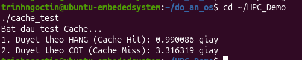

# Technical Report: CPU Cache Locality & Spatial Locality Optimization

## 1. Overview & Objectives
In modern embedded computing and high-performance architectures, CPU processing capabilities drastically exceed the data transfer throughput of main system memory (DRAM). This disparity creates the architectural bottleneck widely known as the **Memory Wall**.

This experiment quantifies the hardware performance penalty induced by suboptimal memory access patterns through a 2D matrix traversal benchmark:
* **Row-Major Traversal:** Contiguous sequential memory access aligned with hardware cache prefetching.
* **Column-Major Traversal:** Non-contiguous strided memory access inducing repeated cache line misses.

---

## 2. Hardware Architecture & Theory
* **Cache Line Transfer:** The processor never fetches individual bytes directly from RAM. Instead, memory transactions transfer data in fixed blocks termed **Cache Lines** (typically 64 bytes).
* **Row-Major Memory Order in C:** C compilers store multi-dimensional arrays sequentially row by row. Iterating across elements of the same row (`arr[i * N + j]` with incrementing `j`) yields consecutive addresses, ensuring that adjacent words reside within the active L1 cache line (**Cache Hit**, latency ~4 CPU cycles).
* **Strided Traversal Penalty:** Iterating down columns (`arr[i * N + j]` with incrementing `i`) enforces a stride of $N \times \text{sizeof(int)} = 10,000 \times 4\text{ bytes} = 40,000\text{ bytes}$. Because this stride exceeds the 64-byte line boundary, nearly every memory request requires an access to main DRAM (**Cache Miss**, latency ~100-200 CPU cycles).

---

## 3. Benchmark Implementation (`cache_test.c`)
```c
#include <stdio.h>
#include <stdlib.h>
#include <time.h>

#define N 10000

double get_time() {
    struct timespec ts;
    clock_gettime(CLOCK_MONOTONIC, &ts);
    return ts.tv_sec + ts.tv_nsec * 1e-9;
}

int main() {
    int *arr = (int *)malloc(N * N * sizeof(int));
    if (!arr) return 1;

    // 1. Sequential Traversal (Row-Major: Cache-Friendly)
    double start1 = get_time();
    for (int i = 0; i < N; i++) {
        for (int j = 0; j < N; j++) {
            arr[i * N + j] = 1;
        }
    }
    double end1 = get_time();

    // 2. Strided Traversal (Column-Major: Cache-Unfriendly)
    double start2 = get_time();
    for (int j = 0; j < N; j++) {
        for (int i = 0; i < N; i++) {
            arr[i * N + j] = 2;
        }
    }
    double end2 = get_time();

    printf("1. Duyet theo HANG (Cache Hit): %f giay\n", end1 - start1);
    printf("2. Duyet theo COT (Cache Miss): %f giay\n", end2 - start2);

    free(arr);
    return 0;
}
```

---

## 4. Empirical Benchmark & Visual Evidence
The binary was compiled with the optimization flag disabled (`-O0`) to observe direct memory architecture behavior without automated vectorization or loop reordering:

bash
gcc -O0 cache_test.c -o cache_test
./cache_test


### Visual Verification


### Performance Measurements

| Traversal Order | Memory Stride | Cache Behavior | Execution Time (s) | Relative Performance |
| :--- | :--- | :--- | :--- | :--- |
| **Row-Major (`i` then `j`)** | `+4 bytes` | Cache Hit | **0.990086 s** | **~3.35x Speedup** |
| **Column-Major (`j` then `i`)** | `+40,000 bytes` | Cache Miss | **3.316319 s** | Baseline (~234.9% Slower) |
---

## 5. Key Engineering Insights
* **Microarchitectural Impact:** Both loops perform the identical total count of arithmetic and store operations ($10^8$ iterations) with the theoretical complexity of $O(N^2)$. However, column traversal experiences an immediate **2.55x performance regression** solely due to memory bus latency and cache eviction overhead.
* **Embedded System Recommendation:** For Edge AI inference engines and real-time vision pipelines, data structures must be flattened to match hardware cache line structures, avoiding pipeline stalls and minimizing system energy consumption.
