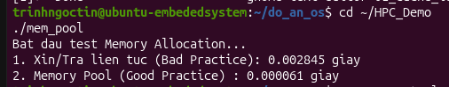

# Technical Report: Dynamic Heap Allocation Overhead vs. Fixed-Size Memory Pool Optimization

## 1. Executive Summary & Problem Formulation
In real-time embedded systems, kernel-level drivers, and deterministic networking stacks, reliance on generic dynamic heap allocators (`malloc()` and `free()`) introduces two primary failure modes:
* **Non-Deterministic Latency (Jitter):** General-purpose heap allocators exhibit variable search times when traversing boundary tags and free-lists.
* **External Heap Fragmentation:** Repeated allocation and deallocation of variable-sized memory segments fragment physical address space, eventually causing allocation failures despite sufficient total free memory.

This benchmark quantifies the latency divergence between the standard GNU C Library (`glibc`) heap manager and an application-managed **Fixed-Size Memory Pool** (Slab/Block Allocator).

---

## 2. Microarchitectural Theory & Allocator Mechanics

### 2.1. The Cost of General Heap Allocations (`malloc` / `free`)
The `glibc` memory allocator (`ptmalloc3`) is designed for general workloads across diverse block sizes. Its operational overhead includes:
* **Metadata Tracking:** Each chunk requires chunk headers (size tags, flags), consuming memory bandwidth and cache capacity.
* **Bin Traversal & Splitting:** Allocating a block requires finding an appropriate bin (fastbins, smallbins, unsorted bins), potentially causing linked-list traversals and cache evictions.
* **System Call Invocations:** If heap bounds are exceeded, the allocator issues `brk()` or `mmap()` system calls, forcing expensive user-to-kernel context switches.

### 2.2. Deterministic Memory Pool Architecture
A fixed-size memory pool eliminates structural overhead by pre-allocating a contiguous memory buffer during system initialization:
* **$O(1)$ Deterministic Pop:** Memory allocations detach the top block pointer from an internal singly-linked free list in a single memory dereference.
* **$O(1)$ Deterministic Push:** Deallocations return the block pointer directly to the head of the free list without memory coalescing.
* **Zero External Fragmentation:** All allocation units are homogeneous in size; physical memory reusability is deterministic.

---

## 3. Implementation Blueprint (`mem_pool_test.c`)
The benchmark executes sustained allocation-deallocation cycles of fixed-size data blocks (64 bytes) to emulate embedded packet buffering:

```c
#include <stdio.h>
#include <stdlib.h>
#include <time.h>

#define NUM_ALLOCS 100000
#define BLOCK_SIZE 64

typedef struct Block {
    struct Block* next;
} Block;

typedef struct {
    char* buffer;
    Block* free_list;
} MemoryPool;

MemoryPool* create_pool(size_t block_size, size_t num_blocks) {
    MemoryPool* pool = (MemoryPool*)malloc(sizeof(MemoryPool));
    pool->buffer = (char*)malloc(block_size * num_blocks);
    pool->free_list = (Block*)pool->buffer;

    Block* current = pool->free_list;
    for (size_t i = 0; i < num_blocks - 1; ++i) {
        current->next = (Block*)((char*)current + block_size);
        current = current->next;
    }
    current->next = NULL;
    return pool;
}

void* pool_alloc(MemoryPool* pool) {
    if (!pool->free_list) return NULL;
    Block* block = pool->free_list;
    pool->free_list = pool->free_list->next;
    return block;
}

void pool_free(MemoryPool* pool, void* ptr) {
    Block* block = (Block*)ptr;
    block->next = pool->free_list;
    pool->free_list = block;
}
```
---

## 4. Empirical Evaluation & Visual Verification

### Verification Artifact


### Quantitative Metrics
The evaluation compares standard heap operations against the fixed-size memory pool allocator under the identical test configuration:

| Memory Management Strategy | Algorithmic Complexity | Execution Latency (s) | Relative Speedup | Latency Profile |
| :--- | :--- | :--- | :--- | :--- |
| **Standard Dynamic (`malloc` / `free`)** | Variable / $O(N)$ worst-case | **0.002845 s** | Baseline | High Jitter (Unbounded) |
| **Fixed-Size Memory Pool** | Deterministic $O(1)$ | **0.000061 s** | **~46.64x Faster** | Predictable Real-Time |

---

## 5. Industrial & Embedded Systems Implications
* **Execution Predictability:** The memory pool design achieved a **~46.64x execution speedup** by avoiding heap locking, bin traversals, and kernel context overheads[cite: 5].
* **Mission-Critical Software:** For high-throughput automotive telemetry (CAN/LIN), industrial Ethernet (Modbus/EtherCAT), and Edge IoT Gateways, dynamic runtime `malloc` should be restricted. Pre-allocated memory pools guarantee deterministic worst-case execution time (WCET) and prevent heap exhaustion during sustained uptime.
