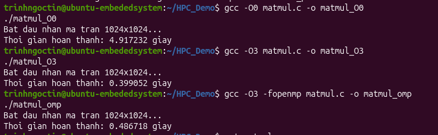

# Technical Report: Compiler Optimization (GCC) and Parallel Computing (OpenMP)

## 1. Experimental Objectives
This benchmark evaluates the latency impact of software-level and hardware-level execution optimizations for heavy numerical workloads:
* **Compiler Optimization Passes:** Measure the efficiency of GCC `-O3` vectorization and instruction pipelining relative to unoptimized `-O0` baseline code.
* **User-Space Parallelism (OpenMP):** Quantify execution overhead and performance scaling when distributing dense matrix operations across concurrent threads.

---

## 2. Theoretical Architecture & OS Fundamentals

### 2.1. GCC Optimization Levels (`-O0` vs. `-O3`)
* **`-O0` (Baseline / No Optimization):** Emits straightforward assembly corresponding directly to source statements. Intermediate scalar values reside strictly in memory/stack frames, leading to frequent CPU memory stalls.
* **`-O3` (High-Performance Vectorization):**
  * **Loop Vectorization (SIMD):** Packs multiple floating-point elements into dedicated CPU vector registers (SSE/AVX), computing multiple arithmetic operations within a single clock cycle.
  * **Register Allocation & Loop Unrolling:** Maximizes register residency and minimizes branch prediction misses.

### 2.2. OpenMP Threading & Execution Cost
The `#pragma omp parallel for` directive instructs the runtime to schedule loop iterations across a dynamic thread pool:
* **Thread Scheduling:** Iterations of the outer loop are split among worker threads managed by the Linux scheduler.
* **Execution Overhead:** Spawning worker threads, barrier synchronization, cache coherence maintenance, and kernel context transitions introduce non-negligible latency penalties.

---

## 3. Benchmark Implementation (`matmul.c`)
The benchmark executes dense matrix multiplication ($C = A \times B$) with matrices sized $1024 \times 1024$ (over 1 billion floating-point Multiply-Accumulate operations):

```c
#include <stdio.h>
#include <stdlib.h>
#include <time.h>
#include <omp.h>

#define SIZE 1024

double get_time() {
    struct timespec ts;
    clock_gettime(CLOCK_MONOTONIC, &ts);
    return ts.tv_sec + ts.tv_nsec * 1e-9;
}

int main() {
    float *A = (float *)malloc(SIZE * SIZE * sizeof(float));
    float *B = (float *)malloc(SIZE * SIZE * sizeof(float));
    float *C = (float *)malloc(SIZE * SIZE * sizeof(float));

    for (int i = 0; i < SIZE * SIZE; i++) {
        A[i] = 1.0f;
        B[i] = 2.0f;
        C[i] = 0.0f;
    }

    printf("Bat dau nhan ma tran %dx%d...\n", SIZE, SIZE);
    double start = get_time();

    #pragma omp parallel for
    for (int i = 0; i < SIZE; i++) {
        for (int j = 0; j < SIZE; j++) {
            float sum = 0.0f;
            for (int k = 0; k < SIZE; k++) {
                sum += A[i * SIZE + k] * B[k * SIZE + j];
            }
            C[i * SIZE + j] = sum;
        }
    }

    double end = get_time();
    printf("Thoi gian hoan thanh: %f giay\n", end - start);

    free(A); free(B); free(C);
    return 0;
}

--- 

## 4. Empirical Evaluation & Visual Verification

### Verification Artifact


### Performance Benchmark Data
The execution times recorded across identical input matrices on the target system are summarized below:

| Optimization Level | Compiler & Execution Flags | Latency (s) | Speedup Factor vs. Baseline | Performance Class |
| :--- | :--- | :--- | :--- | :--- |
| **Baseline (Scalar)** | `gcc -O0 matmul.c -o matmul_O0` | **4.917232 s** | 1.00x | Memory-Stalled Scalar Execution |
| **Compiler Vectorized** | `gcc -O3 matmul.c -o matmul_O3` | **0.399052 s** | **~12.32x Faster** | Vectorized SIMD Pipelining |
| **Multithreaded Parallel** | `gcc -O3 -fopenmp matmul.c -o matmul_omp` | **0.486718 s** | **~10.10x Faster** | Parallelized with Thread Contention |

---

## 5. Technical Root-Cause Analysis (OS & Hardware Perspective)

### 5.1. GCC Vectorization Superiority (`-O3`)
Enabling `-O3` produced an execution latency drop from **4.917 s** down to **0.399 s**, achieving a **~12.32x acceleration**. This gain is driven by automated SIMD vectorization and register caching, bypassing redundant DRAM accesses without modifying the algorithmic structure.

### 5.2. Detailed Analysis: Why OpenMP (0.486 s) Was Slower Than Single-Thread `-O3` (0.399 s)
The empirical observation that the multithreaded binary was ~0.087 s slower than the optimized single-threaded binary highlights fundamental operating system trade-offs under virtualized resource constraints:
1. **Virtual CPU Core Saturation (Core Contention):** In a virtualized guest environment with limited allocated vCPUs, OpenMP worker threads cannot achieve true simultaneous hardware concurrency. Multiple threads compete for identical physical processing cycles.
2. **Context Switching Penalties:** The Linux Completely Fair Scheduler (CFS) must repeatedly preempt running threads, store CPU register contexts to RAM/stack, and restore alternative thread states, introducing execution stalls.
3. **Synchronization & Barrier Latency:** Because `-O3` reduced computational runtime to only ~0.39 s, the relative proportion of time consumed by thread pool initialization, iteration chunking, and final barrier synchronization (`join`) became a substantial performance bottleneck.

---

## 6. Industrial Systems & Edge Computing Implications
* **Compiler Optimization as Primary Step:** In resource-constrained single-core microcontrollers or low-tier edge nodes, maximizing compiler flags (`-O3`, loop unrolling) delivers substantial speedups without adding codebase complexity.
* **Concurrency Trade-Off Consideration:** Parallel threading libraries (OpenMP/pthreads) are only advantageous when the execution duration significantly outweighs thread management overhead and sufficient independent hardware cores are physically provisioned.
