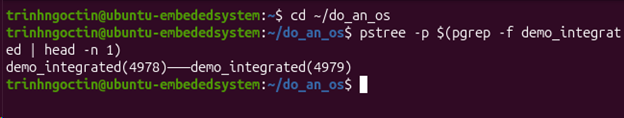
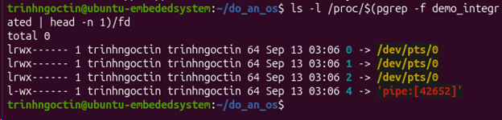
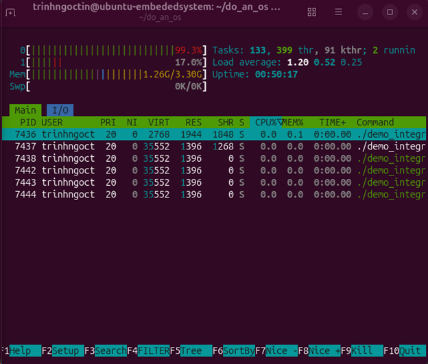
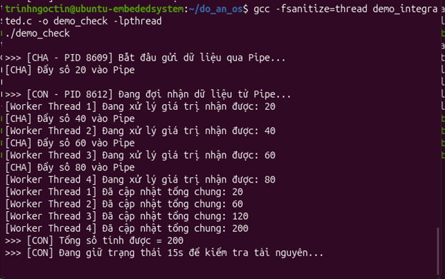

# Empirical Evaluation: Integrated IPC, Multithreading, and Mutex Synchronization

---

## 1. Experimental Overview & Architecture
This practical module validates the convergence of Inter-Process Communication (Topic 2), Synchronization (Topic 3), and Multithreaded Execution (Topic 8) within a single coordinated Linux application.

### Pipeline Architecture

```

[Producer Process (Parent)]
│
│ write(pipe_channel[1])
▼
┌─────────────┐
│ Kernel Pipe │  (Anonymous IPC Buffer)
└─────────────┘
│
│ read(pipe_channel[0])
▼
[Consumer Process (Child)]
│
├── Spawns Worker Thread 1 ──┐
├── Spawns Worker Thread 2 ──┼──> [Critical Section: total_shared_sum]
├── Spawns Worker Thread 3 ──┤         (Synchronized by Mutex)
└── Spawns Worker Thread 4 ──┘

```

* **Producer Context (Parent Process):** Generates telemetry data frames and streams them into an anonymous Unix pipe.
* **Consumer Context (Child Process):** Dequeues data units and dynamically delegates the workload across multiple concurrent POSIX threads.
* **Synchronization Boundary:** Concurrently executing threads accumulate computed results into a shared variable guarded by a mutual exclusion lock (`pthread_mutex_t`).

---

## 2. Integrated Source Code (`demo_integrated.c`)

```c
#include <stdio.h>
#include <stdlib.h>
#include <unistd.h>
#include <pthread.h>
#include <sys/types.h>
#include <sys/wait.h>

#define NUM_ITEMS 4

pthread_mutex_t my_lock;
int total_shared_sum = 0;

typedef struct {
    int worker_id;
    int value;
} WorkerArg;

void* worker_function(void* arg) {
    WorkerArg* data = (WorkerArg*)arg;

    printf("[Worker Thread %d] Processing value: %d\n", 
           data->worker_id, data->value);
    sleep(1);

    // Critical Section: Mutex Lock
    pthread_mutex_lock(&my_lock);
    total_shared_sum += data->value;
    printf("[Worker Thread %d] Updated total sum: %d\n", 
           data->worker_id, total_shared_sum);
    pthread_mutex_unlock(&my_lock);

    free(data);
    return NULL;
}

int main() {
    int pipe_channel[2];

    if (pipe(pipe_channel) == -1) {
        perror("Pipe creation failed");
        return 1;
    }

    pid_t pid = fork();

    if (pid < 0) {
        perror("Fork failed");
        return 1;
    }

    if (pid > 0) {
        // Parent Process: Producer
        close(pipe_channel[0]);
        printf("\n>>> [PARENT - PID %d] Streaming data frames via Pipe...\n", getpid());

        for (int i = 1; i <= NUM_ITEMS; i++) {
            int send_val = i * 20;
            printf("[PARENT] Pushing frame %d into Pipe\n", send_val);
            write(pipe_channel[1], &send_val, sizeof(int));
            sleep(1);
        }

        close(pipe_channel[1]);
        wait(NULL);
        printf(">>> [PARENT] Reaped child process successfully.\n");
    } 
    else {
        // Child Process: Consumer & Multithread Coordinator
        close(pipe_channel[1]);
        pthread_t threads[NUM_ITEMS];
        pthread_mutex_init(&my_lock, NULL);

        printf("\n>>> [CHILD - PID %d] Reading stream and creating threads...\n", getpid());

        int recv_val;
        int count = 0;

        while (read(pipe_channel[0], &recv_val, sizeof(int)) > 0) {
            WorkerArg* arg = (WorkerArg*)malloc(sizeof(WorkerArg));
            arg->worker_id = count + 1;
            arg->value = recv_val;

            pthread_create(&threads[count], NULL, worker_function, (void*)arg);
            count++;
        }
        close(pipe_channel[0]);

        for (int i = 0; i < count; i++) {
            pthread_join(threads[i], NULL);
        }

        pthread_mutex_destroy(&my_lock);
        printf(">>> [CHILD] Final Computed Aggregate Sum = %d\n", total_shared_sum);
        exit(0);
    }

    return 0;
}

```

---

## 3. Empirical Verification & Artifact Analysis

### Artifact 1: Process Hierarchy Verification

* **Diagnostic Command:**
```bash
pstree -p $(pgrep -f demo_integrated | head -n 1)

```


* **Empirical Evidence:**

* **Analysis:**
The kernel process table records parent process `PID 4978` maintaining a direct hierarchical link to child process `PID 4979`. This validates spatial isolation of the address spaces via `fork()` while retaining parent-child genealogical tracking within the kernel Task Scheduler.

---

### Artifact 2: Kernel-Level IPC Descriptor Allocation

* **Diagnostic Command:**
```bash
ls -l /proc/$(pgrep -f demo_integrated | head -n 1)/fd

```


* **Empirical Evidence:**

* **Analysis:**
Inspection of the `/proc/[pid]/fd` interface shows standard streams `0`, `1`, and `2` mapped to `/dev/pts/0`. File descriptor `4` points to an anonymous kernel buffer labeled `'pipe:[42652]'`. This proves that the pipe system call successfully allocated an in-kernel unidirectional channel for inter-process data streaming.

---

### Artifact 3: Multithreaded Core Scheduling

* **Diagnostic Command:**
```bash
htop

```


* **Empirical Evidence:**

* **Analysis:**
The system monitor illustrates distinct lightweight execution units. The coordinator processes (`PID 7436` and `PID 7437`) oversee four concurrent worker threads (`LWP 7438, 7442, 7443, 7444`). All worker threads exhibit identical memory allocations (`VIRT 35552 KB`, `RES 1396 KB`), demonstrating shared address space residency while being independently dispatchable by the Linux Completely Fair Scheduler (CFS).

---

### Artifact 4: Race Condition Elimination via Mutex

* **Diagnostic Command:**
```bash
gcc -fsanitize=thread demo_integrated.c -o demo_check -lpthread
./demo_check

```


* **Empirical Evidence:**

* **Analysis:**
Runtime instrumentation via LLVM/GCC ThreadSanitizer monitored all memory access intervals across threads. The program completed without emitting any `DATA RACE` exceptions, accurately computing the target sum of `200`. This verifies that `pthread_mutex_lock()` and `pthread_mutex_unlock()` successfully serialized critical section entry, ensuring complete deterministic safety.

---

## 4. Execution Workflow

```bash
# 1. Compile integrated application
gcc demo_integrated.c -o demo_integrated -lpthread

'/home/trinhngoctin/do_an_os/images/images_anh1_process_tree.png' # 2. Execute and monitor
./demo_integrated

# 3. Compile and execute with Concurrency Sanitizer
gcc -fsanitize=thread demo_integrated.c -o demo_check -lpthread
./demo_check

```

```

```
