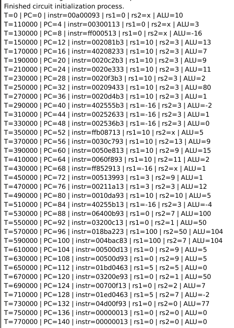
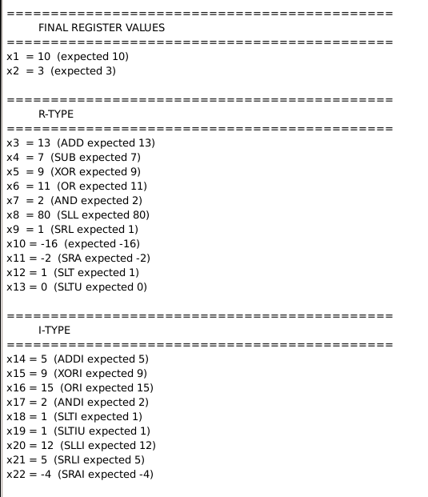
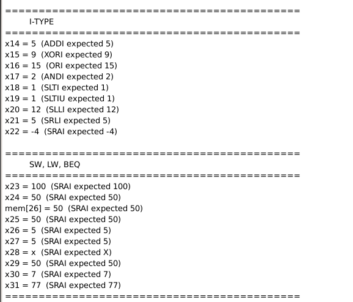

# Embedded-system-final
# Linux
---

## Báo cáo tuần 2
* Tìm hiểu quy trình và lập dàn ý

---

## Báo cáo tuần 3
* học, hiểu và hoàn thành phần 1. Nền tảng Linux System Programming

---

## Báo cáo tuần 4
*  học, hiểu và hoàn thành phần 2. IPC – Inter-Process Communication
*  học, hiểu và hoàn thành phần 3. Synchronization – Đồng bộ hóa
*  học, hiểu và hoàn thành phần 8. Multi-thread / Multi-core Programming
*  kết hợp chạy chung và quan sát kết quả

# Risk-V
---
## Báo cáo tuần 2
- Tìm nội dung đề tài báo cáo: RICS-V + AI + Linux
- Tìm hiểu RICS-V: Phân loại, kiến trúc, data path, tập lệnh
## Báo cáo tuần 3
- Bắt đầu làm RICS-V single cycle
- Hoàn thành tập lệnh R-type
## Báo cáo tuần 4
- Hoàn thành tập lệnh J-type
- Thêm các lệnh load(lw), store(sw), branch(beq) cho datapath.

Test thành công tập lệnh R-type, J-type va sw, lw va beq 

# Báo cáo tiến độ – AI Accelerator

## Báo cáo tuần 1

- Tìm hiểu tổng quan đề tài: RISC-V + AI Accelerator + Linux.
- Xác định vai trò của AI Accelerator trong hệ thống.
- Tìm hiểu hướng thiết kế bộ tăng tốc Convolution cho CNN.

## Báo cáo tuần 2

- Tìm hiểu kiến trúc CNN và quá trình inference.
- Tìm hiểu phép Convolution, Kernel, Stride và Padding.
- Tìm hiểu nguyên lý MAC (Multiply-Accumulate) và PE (Processing Element).
- Xác định kiến trúc AI Accelerator gồm: MAC, PE, PE Array, Buffer, Accumulator, ReLU và Controller.

## Báo cáo tuần 3

- Xây dựng mô hình TinyCNN bằng PyTorch trên bộ dữ liệu MNIST.
- Huấn luyện và đánh giá mô hình TinyCNN.
- Sử dụng ảnh MNIST 28×28×1 làm dữ liệu đầu vào cho Convolution Accelerator.
- Trích xuất kernel Convolution 3×3 đã được CNN học.

## Báo cáo tuần 4

- Quantize Activation và Weight từ Float32 sang INT8.
- Xây dựng dữ liệu kiểm thử cho Convolution Accelerator:
  - Activation INT8.
  - Weight INT8.
  - Config: Input Size, Kernel Size, Stride, Padding, ReLU.
  - Quantization Parameters.
- Xây dựng Python Golden Reference cho phép Convolution INT8.
- Tạo Golden Output INT32 để phục vụ kiểm chứng RTL.
- Chuẩn bị test vector cho quá trình thiết kế và verification AI Accelerator.

  

