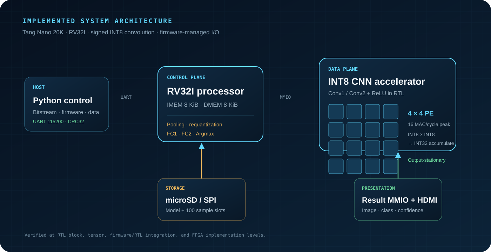
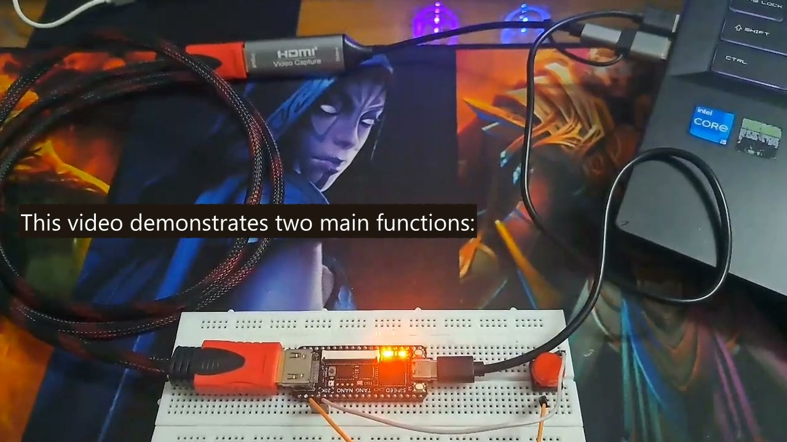
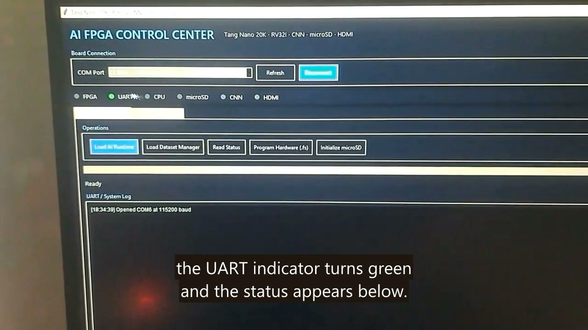
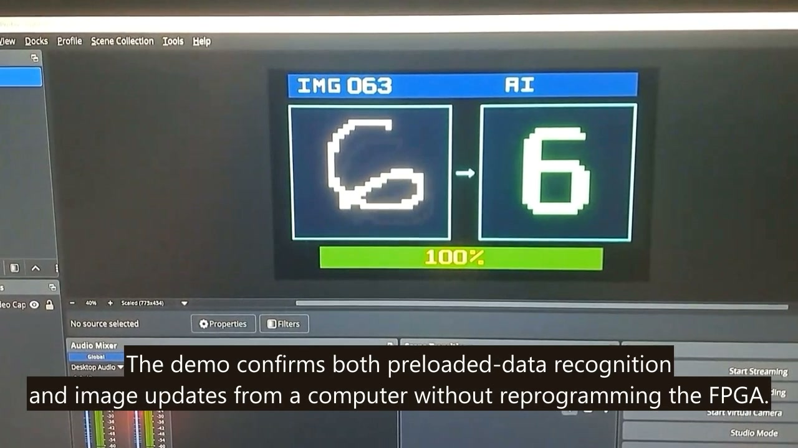
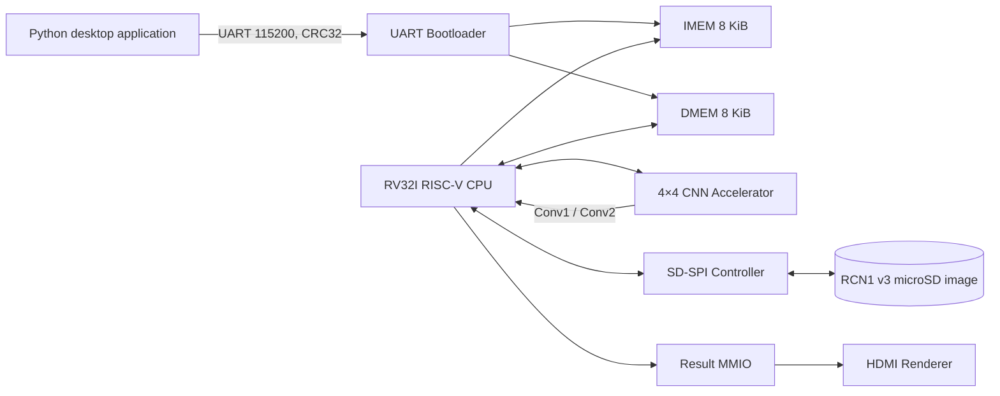
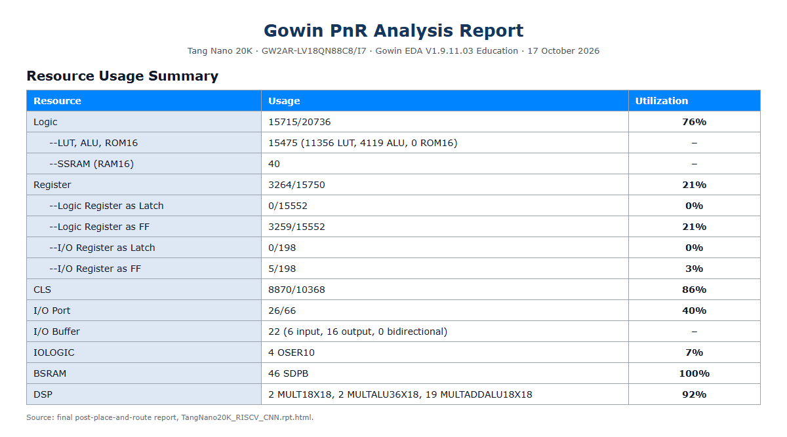
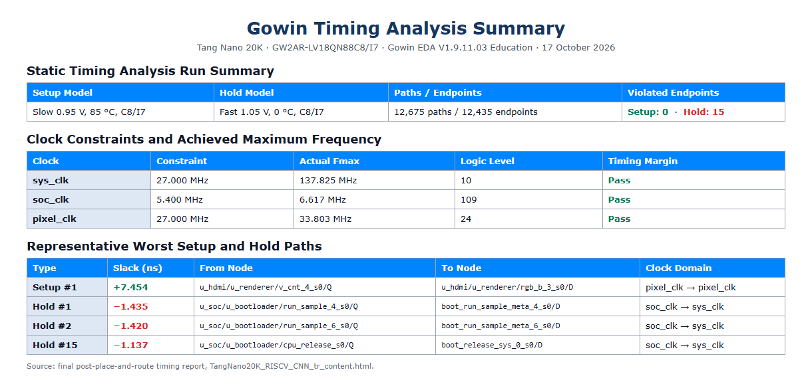

# RISC-V Controlled INT8 CNN Accelerator on FPGA

<div align="center">

**RV32I processor · 4×4 INT8 PE array · microSD · UART bootloader · HDMI · Tang Nano 20K**

[](https://wiki.sipeed.com/hardware/en/tang/Tang-Nano-20K/Nano-20K.html)


[Architecture](#system-architecture) · [Verification](#simulation-and-testing) · [FPGA results](#implementation-status) · [Technical report](Final_Project.pdf)

</div>

This project implements a complete handwritten-digit recognition system on a
Tang Nano 20K FPGA. It combines an RV32I RISC-V CPU, an integer CNN
accelerator, microSD storage, a UART bootloader, a desktop control application,
and HDMI output.

The classifier uses a LeNet-inspired architecture trained for MNIST. The
convolution layers run on a 4×4 parallel hardware accelerator, while pooling,
requantization, fully connected layers, and Argmax run in C firmware on the
RV32I CPU.



## Project Highlights

| Highlight | Verified project evidence |
|---|---|
| Hardware/software co-design | Conv1 and Conv2 in RTL; pooling, requantization, FC1, FC2, and Argmax in bare-metal C |
| Parallel compute | 4×4 PE array with up to 16 signed INT8 × INT8 MAC operations per accelerator cycle |
| Integrated SoC | RV32I, split 8 KiB IMEM/DMEM, UART, SD-SPI, accelerator MMIO, result MMIO, and HDMI |
| Verification | Directed RTL tests, integer golden tensors, SDHC simulation, and firmware-driven end-to-end regression |
| Model result | Float32 and simulated INT8 MNIST artifacts report 99.5%; the reference integer pipeline classifies 98/100 included real samples |
| FPGA evidence | 76% logic, 100% BSRAM, and 92% DSP after place-and-route; setup passes, while 15 hold endpoints remain open |

## Demonstration

| FPGA hardware | Host control application | HDMI inference result |
|---|---|---|
|  |  |  |

The source demonstration video is retained outside the repository because it is
approximately 140 MB. The still frames above document the board, UART control
workflow, dataset update path, and HDMI result.

## My Role & Contributions

This is a **three-member academic team project**. The supplied course report
lists me, Nguyen Phu Huu, as an implementation-group member and records full
progress for all three members. It does not provide an auditable module-level
responsibility breakdown.

To avoid overstating individual ownership, this README treats the processor,
accelerator, firmware, verification environment, host application, and
demonstration as **team outputs**. I do not claim sole authorship of any module
without a member-level responsibility record.

## Key Features

- Recognizes 28×28 handwritten digits from 0 to 9 using an INT8 model.
- Integrates an RV32I CPU and a CNN accelerator in the same FPGA design.
- Uses a 4×4 processing-element array for INT8 multiplication and INT32
  accumulation.
- Reads model parameters and 100 image samples from the onboard microSD slot in
  SPI mode.
- Loads IMEM and DMEM through a CRC32-protected UART bootloader without
  rebuilding the FPGA bitstream.
- Provides a desktop application for programming the FPGA, loading firmware,
  initializing the microSD card, replacing dataset images, and monitoring the
  system.
- Displays the input image, sample ID, prediction, and confidence over HDMI.
- Includes testbenches for SD-SPI MMIO, UART boot, and full CNN inference from
  microSD.

## System Architecture

The host application deploys the FPGA image and firmware. After boot, the RV32I
processor controls storage and acceleration through memory-mapped interfaces;
the accelerator does not access microSD directly.



Inference flow:

1. The firmware reads the input image, weights, and quantization parameters
   from microSD.
2. The accelerator computes Conv1 and Conv2 using INT8 inputs and weights with
   INT32 accumulation.
3. The firmware performs MaxPool, requantization, FC1, FC2, and Argmax.
4. The final result is committed through Result MMIO and displayed over HDMI.

## AI Model

| Stage | Shape | Execution target |
|---|---:|---|
| Input | 1 × 28 × 28, INT8 | microSD / firmware |
| Conv1 + ReLU | 16 × 28 × 28 | CNN accelerator |
| MaxPool + requantization | 16 × 14 × 14 | RV32I firmware |
| Conv2 + ReLU | 32 × 14 × 14 | CNN accelerator |
| MaxPool + requantization | 32 × 7 × 7 | RV32I firmware |
| FC1 + ReLU | 128 | RV32I firmware |
| FC2 + Argmax | 10 classes | RV32I firmware |

According to the artifacts included in this repository, both the Float32 model
and the simulated INT8 model achieve **99.5%** accuracy on the MNIST test set.
The reference integer pipeline correctly classifies **98/100** real handwritten
digit images included with the project.

## Requirements

### Hardware

- Sipeed Tang Nano 20K (`GW2AR-LV18QN88C8/I7`).
- A microSD card using the onboard TF slot.
- An HDMI display.
- A USB cable for the onboard BL616 bridge.
- Optional: an external push button connected between FPGA pin 72 and 3.3 V to
  return the system to the UART Loader.

### Software

- Windows and PowerShell.
- Python 3.10 or later.
- Gowin EDA; the scripts default to
  `Gowin_V1.9.11.03_Education_x64`.
- ModelSim or QuestaSim for Verilog regression tests.
- Zig/LLVM as the RV32I firmware toolchain.

The main desktop application only requires the packages listed in
`requirements.txt`:

```powershell
python -m pip install -r requirements.txt
```

The model-training, model-export, and image-processing scripts may additionally
require `numpy`, `opencv-python`, `torch`, or `python-docx`, depending on the
script being used.

## Board Workflow

Generated bitstreams, firmware images, and raw microSD images are not tracked in
the curated source repository. Build them using [Building from Source](#building-from-source)
before following this board workflow.

1. Connect the Tang Nano 20K to the computer through USB and insert a microSD
   card.
2. Install the dependencies and launch the control application:

   ```powershell
   python -m pip install -r requirements.txt
   python .\AI_FPGA_Control.pyw
   ```

3. Select the correct COM port in the application and click **Connect**.
4. Click **Program Hardware (.fs)** and select the generated bitstream to write
   it to FPGA Flash.
5. Click **Initialize microSD** to write the generated model and dataset image to the
   card.
6. Click **Load AI Runtime** to load the firmware over UART.
7. Connect an HDMI display, use S2 to select a sample, and press and release S1
   to start inference.

> [!CAUTION]
> **Initialize microSD writes directly to raw sectors and erases existing data
> on the selected drive.** Carefully verify the target drive before confirming.

## Board Controls

| Control | Function |
|---|---|
| S1 | Run CNN inference for the selected image |
| S2 | Select or shuffle an image from the 100 slots |
| External button on pin 72 | Hold for approximately 0.5 seconds to return to the UART Loader |
| Busy LED | The accelerator is processing data |
| Done LED | The accelerator operation has completed |
| Error LED | The accelerator has reported an error |
| Heartbeat LED | The FPGA and system clock are running |
| HDMI LED | HDMI PLL lock status |

UART communication uses the onboard BL616 bridge: FPGA RX is assigned to pin
70 and FPGA TX is assigned to pin 69. An external CP2102 module is not required.

## Building from Source

Run the following commands from PowerShell. First, enter the FPGA project
directory:

```powershell
cd .\In_FPGA\RISCV_CNN_AI_Accelerator
```

### 1. Prepare the Toolchain and Build the Firmware

If a compatible Zig installation is not already available:

```powershell
.\firmware_c\bootstrap_toolchain.ps1
```

Build all four firmware variants and generate their IMEM and DMEM images:

```powershell
.\firmware_c\build_firmware.ps1
```

The generated images are written to `firmware_c/build/`. They include the AI
Runtime, Dataset Manager, UART self-test, and HDMI preview diagnostic firmware.

### 2. Generate the microSD Image

```powershell
python .\tools\export_sd_image.py "..\..\Model Training\FPGA_UART_export" .\sd_image
```

The generated `sd_image/model_sd.img` uses the raw RCN1 version 3 format rather
than a FAT filesystem. Model data is stored in immutable sections. The dataset
contains 100 slots, each containing metadata, CRC32 values, and one 28×28 INT8
image.

### 3. Build the FPGA Bitstream

```powershell
.\scripts\build_fpga.ps1
```

If Gowin is installed in a different location:

```powershell
.\scripts\build_fpga.ps1 -GowinBin "C:\path\to\Gowin\IDE\bin"
```

The resulting bitstream is written to
`impl/pnr/TangNano20K_RISCV_CNN.fs`.

## Simulation and Testing

The quick regression builds the firmware and verifies the RV32I instruction
set, SD image, SD-SPI MMIO interface, and UART bootloader:

```powershell
cd .\In_FPGA\RISCV_CNN_AI_Accelerator
.\scripts\run_c_firmware_tests.ps1 -Quick
```

The full regression runs the entire CNN using the simulated SD card. It only
passes when the prediction, sample ID, and preview image all match their
expected values:

```powershell
.\scripts\run_c_firmware_tests.ps1
```

By default, the script looks for ModelSim in
`A:\ModelSim\modelsim_ase\win32aloem`. A different installation can be selected
with:

```powershell
.\scripts\run_c_firmware_tests.ps1 `
    -ModelSimBin "C:\path\to\modelsim_ase\win32aloem"
```

Main testbench files:

- `tb/tb_sd_spi_mmio.v`: tests the SD-SPI MMIO registers and loopback transfer.
- `tb/tb_firmware_c_hello.v`: loads firmware using UART packets and checks the
  READY and PONG responses.
- `tb/tb_firmware_c_full_inference.v`: boots the firmware, reads the simulated
  SD card, and runs full CNN inference.
- `tb/sd_card_spi_model.v`: provides the SDHC model used during simulation.
- `Real_Digits/simulation/tb_real_digit_cnn_accelerator.v`: tests Conv1 and
  Conv2 using real handwritten-digit data.

## Loading Firmware from the Command Line

The desktop application is the recommended interface. For development, the
UART command-line loader can be used directly:

```powershell
python .\tools\uart_bootload.py --port COM5
```

To wait automatically for each UART Loader button press:

```powershell
python .\tools\uart_bootload.py --port COM5 --watch
```

## Main Memory Map

| Region | Address | Size / purpose |
|---|---:|---|
| IMEM | `0x0000_0000` | 8 KiB, RV32I firmware |
| Result/HDMI | `0x1000_0000` | Prediction and sample ID |
| UART | `0x2000_0000` | UART MMIO |
| SD SPI | `0x3000_0000` | microSD controller |
| CNN accelerator | `0x4000_0000` | Configuration, input, weights, and output |
| Result stream | `0x4000_1000` | Result stream to the host |
| DMEM | `0x8000_0000` | 8 KiB, data/BSS/workspace/stack |

IMEM and DMEM are separate physical memories in a Harvard architecture.

## Repository Structure

```text
Big_Project/
├── assets/                              # Architecture and demonstration evidence
├── AI_FPGA_Control.pyw                 # Desktop application entry point
├── Final_Project.pdf                    # Full technical report
├── Summary.pdf                          # Concise project summary
├── requirements.txt                    # Desktop application dependencies
├── Model Training/                     # Notebook, model, and quantized data
├── Real_Digits/                        # Real images, INT8 data, and simulation
└── In_FPGA/RISCV_CNN_AI_Accelerator/
    ├── src/                             # Verilog RTL and constraints
    ├── tb/                              # Main testbenches
    ├── firmware_c/                      # RV32I firmware and toolchain scripts
    ├── tools/                           # GUI, UART, and SD-image utilities
    ├── scripts/                         # Regression and FPGA build scripts
    ├── docs/                            # Short technical notes
    ├── sd_image/                        # Generated RCN1 microSD image (ignored)
    └── impl/                            # Generated FPGA output (ignored)
```

## Implementation Status

According to the included place-and-route report:

| Resource | Usage |
|---|---:|
| Logic | 15,715 / 20,736 (76%) |
| Registers | 3,264 / 15,750 (21%) |
| BSRAM | 46 / 46 (100%) |
| DSP | 22 / 24 (92%) |

Setup timing passes for the reported `sys_clk`, `soc_clk`, and `pixel_clk`
constraints. The timing report still shows **15 hold endpoint violations**,
mostly on `soc_clk` to `sys_clk` paths. Timing closure is therefore not claimed.
Because all BSRAM blocks are currently in use, IMEM and DMEM are limited to
8 KiB each.

| Resource summary | Timing summary |
|---|---|
|  |  |

## Reports

- [Full technical report](Final_Project.pdf)
- [Ten-page technical summary](Summary.pdf)

## Existing Technical Notes

The following files are short development and testing notes, not a complete
documentation set:

- [`TEST_WITHOUT_BOARD.md`](In_FPGA/RISCV_CNN_AI_Accelerator/docs/TEST_WITHOUT_BOARD.md): commands for testing without a physical board.
- [`FIRMWARE_C_FULL_CNN_SD.md`](In_FPGA/RISCV_CNN_AI_Accelerator/docs/FIRMWARE_C_FULL_CNN_SD.md): summary of the firmware, CNN pipeline, and microSD format.
- [`MEMORY_MAP_C_FIRMWARE.md`](In_FPGA/RISCV_CNN_AI_Accelerator/docs/MEMORY_MAP_C_FIRMWARE.md): memory map and MMIO register tables.
- [`UART_BOOTLOADER.md`](In_FPGA/RISCV_CNN_AI_Accelerator/docs/UART_BOOTLOADER.md): summary of the UART Loader and runtime protocols.
- [`IMPLEMENTATION_STATUS.md`](In_FPGA/RISCV_CNN_AI_Accelerator/docs/IMPLEMENTATION_STATUS.md): implementation status and FPGA resource notes.

## Notes and Current Limitations

- `Real_Digits/simulation/tb_real_digit_modelsim.v` and some older simulation
  scripts still refer to the previous `TangNano20K_RISCV_CNN` directory name.
  Their paths must be updated before those legacy flows can be used.
- The firmware is split into the AI Runtime and Dataset Manager because IMEM is
  limited to 8 KiB.
- When a dataset slot is updated, the Dataset Manager only marks it as valid
  after both the image CRC and the microSD read-back verification pass.
- Fifteen hold endpoints remain open in the supplied post-route timing report;
  CDC synchronization and timing re-analysis are priority follow-up work.
- Throughput is reported as a theoretical arithmetic peak. On-board latency and
  PE-utilization measurements have not yet been instrumented.
