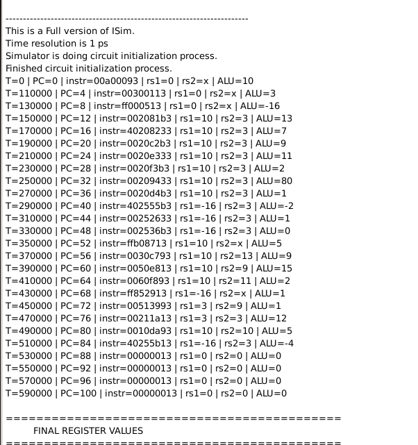
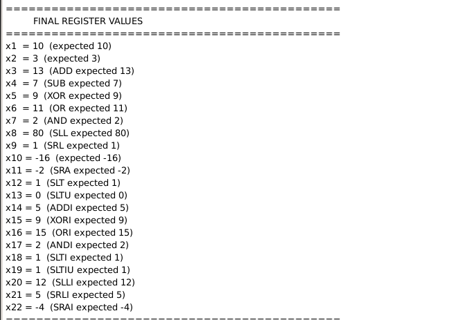

# Embedded-system-final
## Báo cáo tuần 1
- Tìm nội dung đề tài báo cáo: RICS-V + AI + Linux
## Báo cáo tuần 2
- Tìm hiểu RICS-V: Phân loại, kiến trúc, data path, tập lệnh
## Báo cáo tuần 3
- Bắt đầu làm RICS-V single cycle
- Hoàn thành tập lệnh R-type
## Báo cáo tuần 4
- Hoàn thành tập lệnh J-type
- Thêm các lệnh load(lw), store(sw), branch(beq) cho datapath.

Test thành công tập lệnh R và J-type

  
