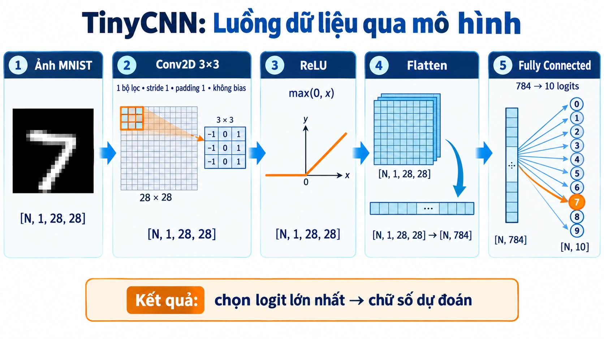
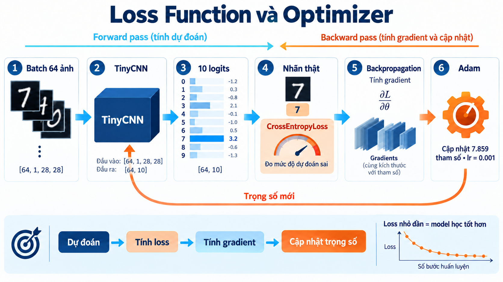
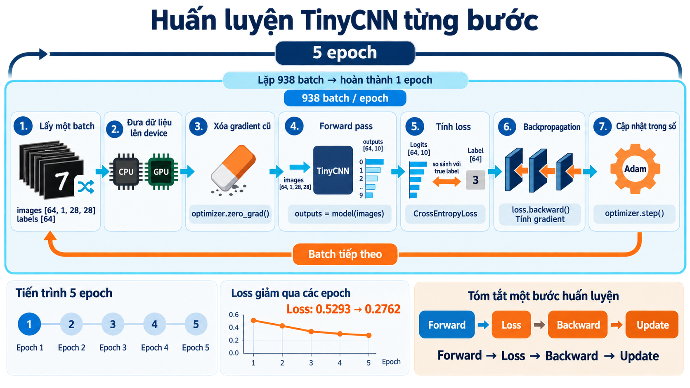
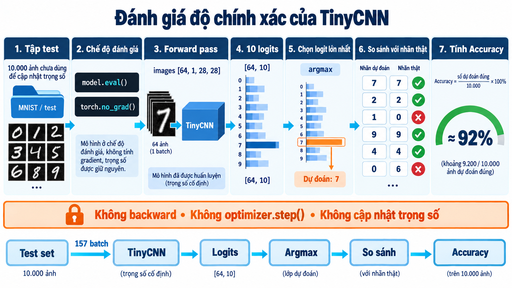
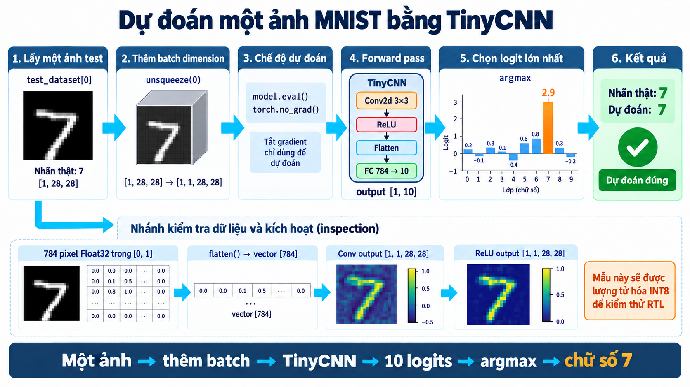

# Báo cáo tuần: TinyCNN MNIST và dữ liệu kiểm thử AI Accelerator

Tuần này mình xây dựng và huấn luyện một mô hình CNN nhỏ bằng PyTorch để nhận dạng chữ số viết tay MNIST. Sau khi đánh giá mô hình Float32, mình lượng tử hóa lớp convolution sang INT8, mô phỏng phép tính số nguyên giống phần cứng và xuất các test vector dùng cho quá trình phát triển RTL/RISC-V AI Accelerator.

## Mục tiêu

- Hiểu cách chuẩn bị dữ liệu MNIST bằng PyTorch.
- Xây dựng một mô hình TinyCNN đơn giản và dễ ánh xạ sang phần cứng.
- Hiểu vai trò của loss, gradient và optimizer Adam.
- Huấn luyện và đánh giá mô hình trên tập test.
- Theo dõi quá trình dự đoán của một ảnh MNIST riêng lẻ.
- Lượng tử hóa activation và convolution weight từ Float32 sang INT8.
- Tạo golden output, test vector TXT/HEX và MAC trace để kiểm thử RTL.

## Pipeline tổng thể

```text
MNIST
  ↓
Prepare Data
  ↓
TinyCNN Float32
  ↓
Train với CrossEntropyLoss + Adam
  ↓
Đánh giá trên 10.000 ảnh test
  ↓
Lượng tử hóa Conv sang INT8
  ↓
Convolution INT8 × INT8 → INT32
  ↓
Golden output + test vector cho RTL
```

## 1. Chuẩn bị dữ liệu MNIST

MNIST đã được chia sẵn thành:

| Tập dữ liệu | Số lượng | Mục đích |
|---|---:|---|
| Training set | 60.000 ảnh | Học và cập nhật trọng số |
| Test set | 10.000 ảnh | Đánh giá trên dữ liệu không dùng để cập nhật trọng số |

Ảnh được chuyển thành tensor bằng `transforms.ToTensor()`:

```text
Ảnh grayscale 28×28, pixel 0..255
              ↓ ToTensor()
Tensor Float32 [1, 28, 28], giá trị 0.0..1.0
```

`DataLoader` chia dữ liệu thành batch 64 ảnh:

```text
images: [64, 1, 28, 28]
labels: [64]
```

Tập train sử dụng `shuffle=True` để xáo trộn ảnh ở mỗi epoch. Tập test sử dụng `shuffle=False` để giữ thứ tự ổn định.

## 2. Xây dựng TinyCNN



Kiến trúc mô hình:

```text
Input [N, 1, 28, 28]
  ↓ Conv2d: 1→1 channel, kernel 3×3, stride 1, padding 1, no bias
[N, 1, 28, 28]
  ↓ ReLU
[N, 1, 28, 28]
  ↓ Flatten
[N, 784]
  ↓ Fully Connected 784→10
[N, 10] logits
```

Số tham số:

| Thành phần | Số tham số |
|---|---:|
| Conv weight | 9 |
| FC weight | 7.840 |
| FC bias | 10 |
| **Tổng** | **7.859** |

Mô hình chỉ sử dụng một convolution filter để giữ phép tính đủ nhỏ và dễ kiểm tra khi triển khai phần cứng.

## 3. Loss function và optimizer



Mình sử dụng:

```python
criterion = nn.CrossEntropyLoss()
optimizer = optim.Adam(model.parameters(), lr=0.001)
```

`CrossEntropyLoss` nhận trực tiếp 10 logits và nhãn class đúng. Không cần thêm Softmax vào cuối model vì CrossEntropyLoss đã xử lý phần tương ứng bên trong.

Adam sử dụng gradient để cập nhật 7.859 tham số. Luồng của một lần học:

```text
Dự đoán → Tính loss → Tính gradient → Cập nhật trọng số
```

## 4. Huấn luyện TinyCNN



Cấu hình huấn luyện:

```python
batch_size = 64
learning_rate = 0.001
num_epochs = 5
```

Với 60.000 ảnh và batch size 64, mỗi epoch có khoảng 938 batch. Mỗi batch thực hiện:

```python
optimizer.zero_grad()
outputs = model(images)
loss = criterion(outputs, labels)
loss.backward()
optimizer.step()
```

Ý nghĩa:

1. Xóa gradient của batch trước.
2. Forward pass để tạo logits.
3. Tính cross-entropy loss.
4. Backpropagation để tính gradient.
5. Adam cập nhật trọng số.

Loss giảm qua các epoch cho thấy mô hình đang học:

```text
Epoch 1: 0.5293
Epoch 2: 0.2997
Epoch 3: 0.2866
Epoch 4: 0.2803
Epoch 5: 0.2762
```

Giá trị cụ thể có thể thay đổi giữa các lần chạy vì notebook chưa cố định toàn bộ random seed của quá trình huấn luyện.

## 5. Đánh giá độ chính xác



Khi đánh giá, mô hình sử dụng:

```python
model.eval()

with torch.no_grad():
    outputs = model(images)
    predicted = outputs.argmax(dim=1)
```

Giai đoạn đánh giá không gọi `backward()` hoặc `optimizer.step()`, vì vậy trọng số được giữ nguyên.

Kết quả từ bundle mới nhất:

| Chỉ số | Kết quả |
|---|---:|
| Số ảnh test | 10.000 |
| Accuracy Float32 | 92,62% |
| Accuracy Conv INT8 + FC Float32 | 92,58% |
| Mức đồng ý giữa hai pipeline | 99,96% |

## 6. Dự đoán một ảnh MNIST



Ảnh đầu tiên của test set có nhãn thật là `7`:

```python
test_image, true_label = test_dataset[0]
input_image = test_image.unsqueeze(0)
```

Shape thay đổi như sau:

```text
[1, 28, 28] → [1, 1, 28, 28]
                  ↑
          batch dimension
```

Mô hình trả về tensor `[1, 10]`. `argmax` chọn class có logit lớn nhất và dự đoán đúng chữ số `7`.

Ảnh gồm 784 pixel Float32. Việc flatten sử dụng thứ tự row-major:

```text
pixel (0,0), (0,1), ..., (0,27), (1,0), ..., (27,27)
```

## 7. Lượng tử hóa INT8

### Weight

Lượng tử hóa đối xứng:

```text
weight_scale = max(abs(weight)) / 127
weight_int8  = clamp(round(weight / weight_scale), -127, 127)
```

Kernel INT8 của lần chạy được xuất trong bundle:

```text
 23  -31    0
 17   98   10
123  127   33
```

### Activation

Ảnh MNIST nằm trong `[0,1]`:

```text
activation_scale = 1 / 127
activation_int8  = clamp(round(activation / activation_scale), 0, 127)
```

Hai zero point đều bằng 0.

### Output convolution

Phần cứng thực hiện:

```text
signed INT8 × signed INT8 → tích lũy signed INT32
```

Giá trị Float32 gần đúng được phục hồi bằng:

```text
output_float ≈ output_int32 × activation_scale × weight_scale
```

Kết quả sai số lượng tử trên ảnh được chọn:

| Chỉ số | Giá trị |
|---|---:|
| Conv mean absolute error | 0,000604 |
| Conv maximum absolute error | 0,008054 |

## 8. Dữ liệu kiểm thử RTL

Bundle `tinycnn_20260912T033601_199965Z.zip` chứa:

- activation INT8 của ảnh MNIST;
- convolution weight INT8;
- golden convolution output INT32;
- golden ReLU output INT32;
- bản TXT và HEX của các vector;
- checkpoint `tinycnn_mnist.pth`;
- 24 directed/random test case;
- `mac_trace.csv` để kiểm tra accumulator theo từng chu kỳ;
- `manifest.json` chứa cấu hình, metrics và SHA-256.

Hợp đồng tính toán với RTL:

| Thuộc tính | Giá trị |
|---|---|
| Input | 1×28×28 |
| Kernel | 1×1×3×3 |
| Stride | 1 |
| Padding | Zero padding 1 |
| Conv bias | Không |
| Input/weight | Signed INT8 |
| Output/accumulator | Signed INT32 |
| Kernel flipped | Không |
| Flatten order | Row-major |

Các test vector bao gồm zero input, zero weight, impulse tại góc/cạnh/trung tâm, giá trị signed cực biên, checkerboard và 10 mẫu random với seed cố định.

## 9. Cách chạy notebook

Yêu cầu Python và các thư viện:

```bash
pip install torch torchvision matplotlib numpy
```

Sau đó mở notebook bằng Jupyter hoặc Google Colab và chạy các cell từ trên xuống dưới. Nếu dùng Colab, cần tải ZIP về máy trước khi runtime bị xóa.

Notebook dự kiến được đặt tại:

```text
notebooks/RISCV_AI_Accelerator_Training.ipynb
```

Bundle kết quả dự kiến được đặt tại:

```text
artifacts/tinycnn_20260912T033601_199965Z.zip
```

## 10. Cấu trúc repository đề xuất

```text
.
├── README.md
├── notebooks/
│   └── RISCV_AI_Accelerator_Training.ipynb
├── artifacts/
│   └── tinycnn_20260912T033601_199965Z.zip
└── docs/
    └── images/
        ├── tinycnn-build-model-infographic.png
        ├── loss-function-and-optimizer.png
        ├── train-tinycnn-step-by-step.png
        ├── evaluate-tinycnn-accuracy.png
        └── single-mnist-prediction.png
```

## 11. Những gì đã và chưa hoàn thành

Đã hoàn thành:

- Huấn luyện và đánh giá TinyCNN.
- Kiểm tra dự đoán một ảnh riêng lẻ.
- Lượng tử hóa input và convolution weight sang INT8.
- Mô phỏng convolution integer và ReLU.
- Xuất golden output và bộ test RTL.
- Kiểm tra lại dữ liệu TXT/HEX và checksum.

Chưa hoàn thành:

- RTL MAC/processing element.
- Mảng PE 4×4 thực tế.
- Controller và tổ chức SRAM/BRAM.
- Giao tiếp AXI/Wishbone/MMIO với RISC-V.
- Driver C chạy trên RISC-V.
- Lượng tử hóa Fully Connected.
- Synthesis, timing và kiểm thử trên FPGA.

## 12. Kế hoạch tiếp theo

1. Viết module MAC signed `INT8 × INT8 → INT32`.
2. Kiểm tra MAC bằng chín bước trong `mac_trace.csv`.
3. Viết convolution engine cho kernel 3×3 và zero padding.
4. So sánh đủ 784 output RTL với golden output.
5. Chạy toàn bộ 24 test case.
6. Thiết kế thanh ghi điều khiển `START`, `BUSY`, `DONE`.
7. Kết nối accelerator với RISC-V qua MMIO.

## Kết luận

Kết quả tuần này tạo được cầu nối từ mô hình PyTorch sang dữ liệu kiểm thử phần cứng. TinyCNN đạt khoảng 92,6% accuracy trên MNIST, trong khi việc lượng tử hóa riêng lớp convolution sang INT8 gần như không làm giảm độ chính xác. Bộ vector đã xuất là nền tảng để triển khai và xác minh MAC/Convolution accelerator ở bước tiếp theo.
